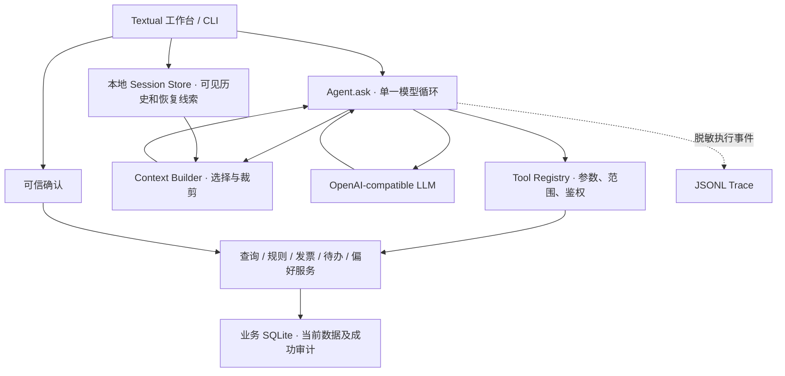

# Economy-guy 初赛设计说明

## 问题与方案

财税对话常省略企业、月份和发票编号。模型可能把上一轮金额当成现值，把两个企业的同号发票混在一起，也可能在程序实际未提交时给出成功答复。Economy-guy 让模型负责理解、追问和提出调用。程序把候选参数同可信身份、当前请求及数据库证据对照，执行后用真实工具结果和回执组织答案。

赛题二初赛实现的三条主链是带规则依据的财务查询、经确认的发票修改、可跨进程恢复的缺用途待办。会话恢复与偏好支持连续工作。金额按整数分处理，Excel 用作只读导入源，SQLite 持有当前业务事实。

## 核心架构

工作台和 CLI 共享 `Agent.ask`。模型收到白名单工具与必要上下文，可以发起查询或准备变更。Tool Registry 验证 JSON 参数、可信范围及企业权限，多工具请求逐 ID 配对。工具不可直接执行 SQL、发布规则或提交财务修改。短查询直接调用业务工具。复杂请求由同一模型提出短计划，Harness 根据可验证进展和剩余预算决定是否继续。单轮上限为 9 次模型请求、12 次实际 Handler 调用、2 次续期、1 次显式重规划。

## 三条关键业务链

**A · 查询和规则。** 从本轮明确输入、可信只读焦点及仍有效的引用确定企业与完整账期。缺少可靠范围时追问。Handler 重查读取权限，核对请求范围，再使用当前 SQLite 查询。综合查询用 R001 分别报告发票价税合计、银行收入与支出。缺用途检查依据当前唯一适用规则返回发票和规则版本。空记录、权限拒绝、范围冲突分别表达。界面用工具证据显示业务结果。

**B · 受控发票修改。** 用户明确目标和新值后，Prepare 按企业与发票编号定位，只能准备用途或备注变更。工作台展示原值、新值和目标，绑定该草稿的用户确认后才进入 Commit。事务再次核对权限、内容指纹和旧值，将更新与成功审计原子提交。随后新连接 Readback 检查当前值。稳定请求编号用于幂等核查。结果未知时按编号查审计，银行及其他发票字段保持只读。

**C · 持久待办。** 以缺用途检查为业务入口，只有明确要求并确认具体对象与内容后才保存任务。Task Manager 按可信账号与企业维护任务，约束同用户同企业只存在一个未完成任务。重启后用任务 ID 找回记录，重新鉴权并按当前规则和发票重新核对进度。任务状态不代替发票修改授权。补齐后以当前检查结果核实剩余项。

## 记忆、审计与评审证据

Stage 3A 管理持久任务和明确保存的企业偏好。Stage 3B Context Builder 选择完整近期轮次及必要线索，Reference Resolver 从实际展示的有序发票联合键解析有限指代，命中后重新鉴权和查库。P0.5 的本地 Session Store 按可信账号和账簿身份隔离，保存可见历史、处理状态及恢复线索。恢复创建新 Agent。旧回合的用户问题、工具类型和只读范围可以帮助继续对话，当前金额、任务进度和权限要重新读取。草稿、确认、私有模型消息和单轮计划不会恢复。个人表达习惯由本地会话存储管理，企业偏好继续由业务 Preference Store 管理，均受当前明确要求约束。

规则版本、工具调用、审计编号和回读使失败能够定位到具体层。独立模拟管理员管理规则，业务查询和用途检查共享同一规则判定。SQLite 的事务审计用于确认提交，脱敏 Trace 用于核查当时调用了什么、为什么停止。评审可独立更换虚构样例库、查看规则来源或重启核对，界面显示与业务状态可以分别验证。

这是比赛模拟身份下的可运行原型。离线测试、Mock 演示和真实模型验收分别记录。核心业务和 C/D 多轮交互已有用户真人 Qwen Windows TUI 证据。近期新增的排序和一级新对话，以及评审机器与账号环境仍待独立确认。见[真人 Live 记录](LIVE-ACCEPTANCE.md)和[现行架构](https://github.com/knone32/Economy-guy/blob/preliminary-2026-v1.0.0/docs/ARCHITECTURE.md)。
